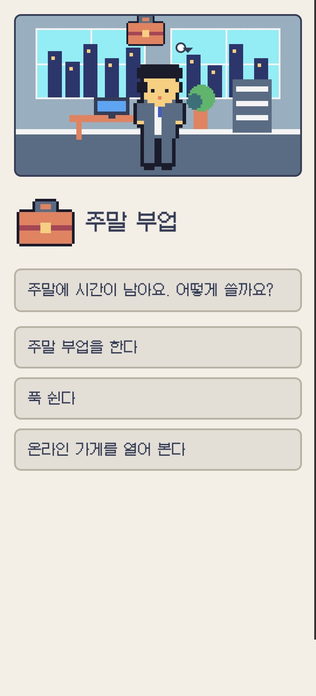
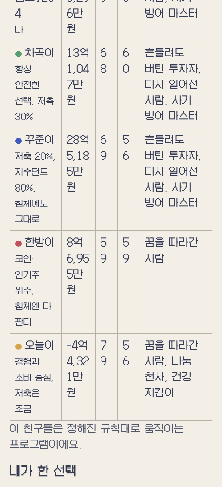

# 실행 플레이테스트 · 밸런스 · 그래픽 개선 보고서

검사일: 2026-10-27 / 기준 커밋: `7928da5` / 실행 환경: macOS Chrome, Node v24.15.0

## 1. 이번에 실제로 한 일과 결론

Chrome에서 로컬 `index.html?seed=1234&fair=1`을 열어 **12세 → 80세까지 직접 조작해 완주**했다. 시작 카드, 진학·취업·독립·보험·은퇴·건강 선택, 지갑, 마디 질문, 엔딩과 인쇄 미리보기를 확인했다. PC 화면 외에 Chrome의 360px 반응형 화면도 검사했다.

결론은 다음과 같다.

- 진행을 막는 오류는 이번 완주와 대량 검사에서 발견하지 못했다.
- **선택 없는 해는 읽기 전에 지나간다.** 기본 1배속도 한 해 1.6초이며, 8배속은 0.2초다. 결정 뒤 4초 휴식이 있어 전체 게임이 무조건 짧다고 단정할 수는 없지만, 중간 로그를 읽기에는 부족하다.
- **NPC 밸런스 검사가 실제로 실패한다.** 공정·무작위 모드 모두 꾸준이 평균 자산이 차곡이보다 낮았다. 오늘이는 약 절반이 적자로 끝났다.
- **그래픽 파일 자체의 손상은 발견하지 못했다.** 그러나 CSS 때문에 이벤트 아이콘이 말풍선 밖으로 나가고 모바일에서 잘리는 문제가 있다.
- **모바일 엔딩 표에서 숫자가 갈라진다.** 가로 넘침이 없어도 결과를 편하게 읽을 수 있는 상태는 아니다.

이번 작업에서는 게임 코드와 기존 문서를 수정하지 않았다. 보고서와 검사 증거만 추가했다. 이전 코드 검토 이후 수정된 버전을 검사했으므로, 과거 보고서의 버그가 모두 그대로 남아 있다는 뜻은 아니다. 기존 회귀 검사는 이번에 통과했다.

## 2. 검사 구성과 근거

| 검사 | 규모와 방식 | 결과 |
| --- | --- | --- |
| 실제 Chrome 플레이 | 세계 1234, 공정 모드, 남자 캐릭터, 1배속 시작 후 주로 8배속 | 80세 엔딩 도달, 용어 18/18 |
| 실제 결과 | 진학 → 중소기업 → 셰어하우스 → 비혼 → 퇴직금 분할 수령 등 | 순자산 14억 6,296만원, 행복 49, 건강 77, 관계 58, 실력 97 |
| 모바일 | Chrome 반응형 360px | 이벤트 장면·엔딩·표에서 문제 확인 |
| 인쇄 | 위 완주 결과의 Chrome 인쇄 미리보기 | 1쪽 확인. 마디 답변은 모두 건너뛴 표본 |
| 데이터·기존 회귀 | `node tools/check-data.js`, `node tools/regress.js` | 모두 통과 |
| 일반 플레이 | 공정/무작위 각 3,000개 세계, 시드 1000~3999 | NaN·범위 오류·막힌 선택지 0, 결정성 통과 |
| NPC | 공정/무작위 각 3,000개 세계 × 친구 4명 | 두 모드 모두 밸런스 기준 일부 실패, 종료 코드 1 |
| 선택지 비교 | `node tools/balance.js 500` | 다섯 영역에서 모두 앞선다는 표시 0개. 희귀 선택의 표본 부족에 주의 |
| 추가 실험 | 같은 1,000개 세계에서 선택 규칙·저축·집중 정책 비교 | 아래 표에 오늘 물가 기준으로 정리 |
| 이미지 | 시트 6개, 프레임 163개 좌표 검사, 아바타 120개 모아 보기 | 이미지 크기·프레임 경계·아바타 조합 누락 오류 0 |
| 애니메이션 | 기본 재생 관찰, DevTools에서 호흡 애니메이션 10% 재생 | 두 프레임 전환에서 다른 칸이 튀어나오는 현상은 관찰하지 못함. 모든 전환의 느린 재생을 검사한 것은 아님 |

실제 조작 중에는 화면 분석과 도구 호출을 위해 여러 번 멈췄다. 따라서 이번 완주에 걸린 벽시계 시간을 **학생의 실제 플레이 시간으로 사용하지 않는다.** 학생이 읽고 고민하며 20~25분 안에 끝내는지는 별도 수업 테스트가 필요하다.

검사 원자료: [측정값 JSON](playtest-assets/measurements.json), [공정 모드 결과](playtest-assets/events-fair.txt), [무작위 모드 결과](playtest-assets/events-random.txt), [NPC 공정](playtest-assets/npc-fair.txt), [NPC 무작위](playtest-assets/npc-random.txt), [선택지 비교 전체](playtest-assets/balance.txt).

## 3. 진행 속도와 플레이 리듬

### P01 · 비결정 연도의 체류 시간이 너무 짧다

근거: `data/economy-data.js:70`, `js/screens/year.js:31`, `js/screens/year.js:38`.

| 배속 | 보통 한 해의 화면 체류 | 결정 후 첫 한 해의 최소 휴식 |
| --- | ---: | ---: |
| 1× | 1.6초 | 4초 |
| 2× | 0.8초 | 4초 |
| 4× | 0.4초 | 4초 |
| 8× | 0.2초 | 4초 |

추가 무작위 선택 실험 1,000개 세계에서 한 인생은 평균적으로 갈림길 약 31회, 선택형 운 카드 약 2회, 자동 운 카드 약 14회, 작은 일 약 38회, 인생 이야기 약 17회를 포함했다. 선택하지 않는 해는 약 36년이었다. 마디 질문과 지연 결과를 제외해도 읽을 내용은 상당하다.

한 번에 보이는 로그는 최근 8개뿐이다. 선택 없이 5년 지나가는 구간이 표본의 중앙값이었고, 이런 구간은 8배속에서 약 1초 만에 흐른다. 사건·이야기·결산이 여러 줄씩 추가되므로 화면에서 내용을 놓치기 쉽다. 실제 플레이에서도 30대 후반과 은퇴 이후는 여러 해가 연달아 지나갔다.

**추천:** 일반적인 빈 해와 새 이야기가 생긴 해의 속도를 나눈다. 새 직장·첫 독립·침체·큰돈 지출·새 용어가 나오면 3~5초의 읽기 시간을 주고, 반복적인 결산은 기존 배속을 유지한다. 모든 해를 일괄적으로 느리게 만들 필요는 없다.

### P02 · 초반에는 결정이 몰리고, 후반에는 구경 시간이 많다

| 나이 | 해당 구간의 결정 발생 횟수, 추가 실험의 평균 근사 |
| --- | ---: |
| 12~19세 | 7회 |
| 20~29세 | 9~10회 |
| 30~49세 | 8회 |
| 50~64세 | 5회 |
| 65~80세 | 4회 |

현재는 앞부분에서 ‘알림 → 이벤트 → 결과 → 메인’을 자주 반복하고, 뒤에서는 읽을 일이 생겨도 빠르게 흐른다. 버튼이 많은 초반과 수동 개입이 적은 후반의 차이가 크다.

**추천:** 알림을 눌러 진입하는 단계를 줄여 메인 화면 안에 선택 패널을 펼치는 방식을 검토한다. 후반에는 매년 선택을 추가하기보다, 5년마다 ‘지금의 나’ 요약과 지출·집중 계획을 다시 확인하게 하면 좋다.

추가 실험의 현재 타이머만 계산하면, 한 인생의 대기 시간은 평균 약 **1배속 185초 / 2배속 156초 / 4배속 142초 / 8배속 135초**였다. 이는 읽기·선택·질문·클릭·카드 전환 시간을 제외한 모델값이며, 화면 재진입이나 수동 넘기기도 제외했다. 결정 뒤 4초 휴식이 비중을 많이 차지해, 배속을 올려도 전체 대기 시간 차이는 약 50초에 그친다.

**해석:** 게임 전체를 억지로 25분에 맞춰 늘리기보다, ‘새로운 정보를 읽을 수 있는가’와 ‘결정 횟수가 부담스럽지 않은가’를 먼저 조정하는 편이 낫다.

## 4. 밸런스 결과

### B01 · NPC 결과가 의도한 기준을 충족하지 않는다

공정 모드 3,000개 세계, 금액은 **2026년 구매력으로 환산한 만원**이다.

| 친구 | 평균 순자산 | 중앙값 | 표준편차 | 최종 적자 |
| --- | ---: | ---: | ---: | ---: |
| 차곡이 | 44,841 | 40,114 | 25,476 | 16/3,000 · 0.5% |
| 꾸준이 | 41,201 | 32,778 | 33,002 | 18/3,000 · 0.6% |
| 한방이 | 54,252 | 39,010 | 133,479 | 90/3,000 · 3.0% |
| 오늘이 | 5,129 | 1 | 14,026 | 1,496/3,000 · 49.9% |

무작위 시작에서도 차곡이 평균 50,628 > 꾸준이 43,026이었고, 오늘이는 1,355/3,000, 약 45.2%가 적자였다. 표본을 1,000개에서 3,000개로 늘려도 기준 실패가 유지됐다.

한방이는 평균이 가장 높지만 중앙값은 차곡이보다 낮고 극단적인 결과의 영향이 크다. **평균 하나로 ‘위험한 투자가 유리하다’고 결론 내리면 안 된다.** 오늘이도 추가 1,000개 세계에서는 최종 행복 중앙값 88·건강 95로 다른 친구보다 높았다. 돈과 삶의 다른 영역을 함께 보여 주는 현재 방향은 유지할 가치가 있다.

원인 분리를 위해 차곡이의 선택 규칙·인물 난수 번호를 유지한 추가 실험도 했다.

| 차곡이와 같은 규칙의 변형 | 평균 순자산, 만원 | 중앙값 |
| --- | ---: | ---: |
| 원래 정책: 저축 30%, 지수 30% | 46,201 | 41,446 |
| 저축 20%, 지수 80%로 변경 | 48,149 | 38,936 |
| 저축 30%, 지수 80%로 변경 | 61,491 | 46,596 |

투자 비중만의 문제로 단정하기 어렵다. 실제 친구들은 저축률·선택 가중치·개인 운도 다르다. 이 실험 역시 상태에 따른 후속 선택 가능성까지 완전히 같게 고정한 것은 아니다.

**추천:** 친구 설명과 비교 목적부터 정한다. 금융 방식 비교용이면 직업·가족·큰 소비를 맞춘 비교를 별도로 제공하고, 현재의 서로 다른 삶 비교도 남긴다. 특정 친구가 반드시 1등이 되도록 수익률만 올리는 방식은 권하지 않는다. 오늘이에게는 생활을 전부 바꾸기보다 지출 한도·소액 비상금처럼 경험 소비와 함께 쓸 수 있는 규칙을 추가해 재검사한다.

### B02 · 공정 모드에서 내 집 구매 경로가 거의 열리지 않는다

일반 3,000회 검사에서 주택 경험은 반올림 출력으로 공정 모드 0%, 무작위 모드 7%였다. 이 0%를 정확히 0명이라고 해석하면 안 된다.

별도 1,000회 검사에서는 주택 구매 선택이 가능했던 인생이 **7명**, 주택 보유 경험은 **5명**이었다. E19 당시 유동 자금 중앙값은 약 **1억 997만원**, 필요한 자기자금 중앙값은 약 **8억 1,353만원**이었다. 이 두 금액은 각각의 중앙값이므로 특정 한 사람의 부족분을 뜻하지 않는다.

근거: `data/economy-data.js:20`, `data/events-adult-data.js:20`, `js/housing.js:31`. 집 마련을 묻는 시점이 이른 데다, 공정 모드는 대도시 가격에서 출발한다. 도시를 옮겨도 이미 E19를 사용한 뒤라 구매를 다시 물어보는 경로가 제한된다.

**추천:** 초기 기본 주택을 작은 주거형으로 두고 넓은 집을 별도 단계로 분리하거나, 40대에 재검토 기회를 준다. 집을 꼭 사야 좋은 결과가 되게 만들 필요는 없다. 학습용 교사 시드에는 월세·전세·주택대출의 실제 선택 가능 여부를 표시하면 좋다.

### B03 · 저축률의 이름과 실제 계산 기준이 다르고, 높이는 대가가 거의 없다

근거: `js/economy.js`의 `invest = net * s.saveRate`, `js/screens/wallet.js`의 ‘월급에서 모으는 비율’.

실제 기준은 월급 전체가 아니라 **생활비·이자·상환을 제외한 남은 돈**이다. 높은 저축률을 고르면 소비를 줄이는 대신 남는 현금을 투자 계좌로 옮긴다. 행복·건강·생활비는 직접 변하지 않는다.

같은 선택 규칙, 기본 저축 20%, 지수 80%, ‘건강과 여가’ 집중을 기준으로 바꾼 1,000개 세계의 결과다. 모든 금액은 오늘 물가 기준 만원이다.

| 변경한 설정 | 자산 평균 | 중앙값 | 하위 10% 지점 | 적자율 | 행복 중앙값 |
| --- | ---: | ---: | ---: | ---: | ---: |
| 예금 100% | 20,433 | 20,041 | 5,877 | 3.5% | 96 |
| 지수 80% · 기준 | 37,191 | 30,591 | 9,528 | 1.7% | 96 |
| 인기주 50% + 코인 50% | 21,173 | 12,494 | 1,672 | 6.0% | 96 |
| 저축률 0% | 16,831 | 16,193 | 2,152 | 5.6% | 96 |
| 저축률 50% | 62,615 | 46,251 | 13,967 | 1.0% | 96 |

이는 게임 안의 결과이며 실제 금융상품의 전망이 아니다. 상태 변화로 후속 개인 운과 조건부 경로는 달라질 수 있다. 이 정책에서는 위험 자산의 평균이 낮아도 극단적인 이익을 얻는 세계는 존재한다.

**추천:** 문구를 ‘남은 돈 중 저축·투자할 비율’로 바로잡는다. 높은 저축률에 임의로 행복 벌점을 주기보다, 비상금 목표·곧 쓸 돈·장기 자금으로 나누어 유동성 판단이 생기게 만든다. 현재의 높은 비율이 항상 같은 답이 되는지 여러 정책에서 다시 확인한다.

### B04 · 노후의 경험 소비는 비용에 비해 지속적인 만족이 약하다

근거: `data/events-senior-data.js` E32, `js/events.js:115`의 능력치 자연 변화.

여행·배움 선택은 연 1,000의 비용이 16년 지속되지만 행복 +8은 한 번만 적용된다. 건강 검진 등도 장기 비용과 일회성 능력치 보상이 섞여 있다. 행복 차이는 매년 6%씩 줄어, 15년 후에는 최초 차이의 약 40%만 남는다.

500개 세계 선택지 검사에서 E32 ‘여행·배움’은 무작위 기준보다 자산 약 5,689만원 감소·최종 행복 +0.8, ‘아끼기’는 자산 약 6,942만원 증가·행복 -0.5였다. 후속 운도 달라질 수 있으므로 정확한 인과 효과로 보지는 않는다. 다만 장기 비용에 비해 최종 화면의 만족 차이가 약해지는 경향을 확인할 근거는 된다.

**추천:** 계속하는 활동에는 작은 연간 만족 효과를 주고, 은퇴 소비 계획은 3~5년마다 조정할 수 있게 한다. 엔딩에는 최종 행복 외에 ‘즐겁게 보낸 해’, ‘배움과 경험 기록’도 함께 보여 준다.

### B05 · 일찍 선택을 다 끝내서 못 나오는 운 카드가 있다

공정·무작위 3,000회 검사 모두 R01 ‘지갑을 주웠다’가 0회였다. 단순한 희귀 사건으로 보기 어렵다.

근거: `js/events.js:168`, `data/random-events-data.js` R01. R01은 19세 이하 선택형 카드인데, 12~17세와 19세는 필수 결정이 있고 18세는 전년도 결정 때문에 선택형 카드가 쉬는 해다. 현재 기본 흐름에서는 뽑을 기회가 없다.

**추천:** 18세의 작은 선택을 허용하거나, 청소년 운 카드의 휴식 규칙만 조정한다. 학급에 모두 보여 줄 필요는 없지만, 콘텐츠별 ‘발생 가능한 경로가 존재하는가’ 검사는 추가해야 한다. S14 코인 이야기가 일반 검사에서 0회인 것은 검사 정책이 지갑에서 코인을 배분하지 않는 영향도 있어, R01과 구분한다.

## 5. 그래픽·UI 검사 — full

기존 바닐라 JS와 `css/style.css`·`css/year.css`를 기준으로 검토했다. 아래 제안은 현재 스타일 안에서 적용하는 방향이다. 새 라이브러리나 외부 이미지 서비스를 전제로 하지 않는다.

| 범주 | 실제 확인한 근거 | 결과 |
| --- | --- | --- |
| Typography | PC/360px 엔딩 표, 그래프 눈금, 카드 문구 | G02, G03 |
| Surfaces | 이벤트 말풍선, 캐릭터·장면 비율, 세 칸 메인 구성 | G01, G04, G06 |
| Animations | 기본 진행·알림·카드·호흡, 호흡 10% 재생 | 호흡 시트 이동 오류 미발견; G05 개선 제안 |
| Icons | 이벤트 장면 스크린샷, 아틀라스 프레임 좌표 | 원본 누락·범위 오류 없음; CSS 배치 오류 G01 |
| Performance | 8배속 화면 재생성, 읽기 체류, 엔딩 그래프 | 멈춤 오류 미관찰; G04와 진행 리듬 개선 필요. 저사양 기기 프로파일링 미실시 |

### 확인한 문제와 개선 방법

| Severity | Location | Before | After | Why |
| --- | --- | --- | --- | --- |
| HIGH · G01 | `css/style.css:135`, `css/year.css:45`, `js/ui.js:77` | 이벤트 아이콘이 작은 빈 말풍선 밖으로 밀려나며, 360px에서 위쪽이 잘림 | 캐릭터 위치 규칙을 `.scene > .sprite.breathe`로 제한. 말풍선 아이콘은 정상 흐름으로 배치. 모바일 배율과 말풍선 위치를 함께 조정 | 자식 아이콘에도 캐릭터의 absolute·음수 margin이 적용된다. 시각적 정보가 잘리고 장면이 깨져 보인다. |
| HIGH · G02 | `css/style.css:119`, `css/style.css:120`, `js/screens/end.js:23` | 360px 비교 표에서 ‘68’이 ‘6 / 8’로, 금액도 여러 조각으로 갈라짐 | 숫자 셀은 nowrap. 표에 최소 너비를 두어 기존 `.scroll`로 스크롤하거나, 모바일에서는 친구별 카드로 변환 | 핵심 결과 수치를 한눈에 읽을 수 없다. 페이지 가로 넘침 0만으로 반응형 통과를 판정하면 놓친다. |
| LOW · G03 | `js/screens/graph.js:18`, `js/screens/graph.js:35` | 최저 자산 눈금이 왼쪽 경계에 걸림. 실제 ‘-1631만’ 글자 너비 약 49px, 여유는 48px | 모든 y축 라벨의 measureText 결과로 왼쪽 여백 계산. 넓은 수치는 억 단위로 단축 | 음수 부호와 자산 크기를 정확히 읽도록 한다. 실제 완주 결과로 확인했다. |
| MEDIUM · G04 | `js/screens/year.js:38`, `js/ui.js:18`, `css/style.css:134` | 매년 전체 화면 교체·상단 이동. 장면과 최근 로그가 세로 공간을 많이 차지함 | 메인 틀을 유지하고 값·로그·장면만 갱신. 모바일은 작은 상태 헤더와 접을 수 있는 장면 제공 | 진행을 보다가 스크롤 위치와 읽던 부분이 바뀐다. 공간보다 중요한 것은 수치와 선택의 맥락을 유지하는 일이다. |
| MEDIUM · G05 | `css/year.css:35`, `css/year.css:45` | 알림 pulse와 말풍선 bob이 결정할 때까지 반복됨 | 등장 시 1회 강조 후 고정. 새 사건 아이콘·테두리·텍스트로 상태 유지 | 매년 반복되는 상호작용에서는 움직임을 줄여 글과 선택에 집중하게 한다. reduced-motion 처리는 이미 있으므로 유지한다. |
| LOW · G06 | `assets/pxl/avatar.px.js:25`, `js/ui.js:70`, `assets/pxl/backgrounds.px.js`, `assets/pxl/places.px.js` | 배경은 화면 폭에 맞춰 늘고 캐릭터는 고정 4배여서 모바일에서 인물 비중이 큼. 나이·직업 차이는 기본 모양·색으로 표현 | 화면 폭별 정수 배율과 발 위치 기준을 공유. 가구·인물의 명암 1단계, 직업 소품, 작은 표정·자세 차이를 추가 | 픽셀의 일관성을 유지하면서 장면의 깊이와 상태 구분을 개선한다. 원본 해상도만 크게 만드는 것보다 효율적이다. |

### 실제 화면 증거

PC 첫 월급 장면에서도 동전 아이콘과 빈 말풍선이 떨어져 있다. [PC 장면 보기](playtest-assets/desktop-event.png).

360px 장면의 아이콘 잘림:

360px 엔딩 비교 표의 금액·능력치 줄바꿈:

추가 증거: [모바일 엔딩과 그래프](playtest-assets/mobile-ending.png), [아바타 120프레임 검사표](playtest-assets/avatar-contact.png).

### 그래픽 수정의 구체적인 순서

1. **G01의 CSS 범위부터 수정한다.** 예를 들어 캐릭터에만 `.scene > .sprite.breathe`를 적용하고, `.bubble .sprite`에는 캐릭터용 위치·margin을 적용하지 않는다. 이것만 고치면 모바일 말풍선의 높이가 커질 수 있으므로 다음 단계도 함께 검사한다.
2. **캐릭터·말풍선의 기준점을 통일한다.** 모바일은 캐릭터 3배, 넓은 화면은 4배 같은 정수 배율을 검토한다. 표시 크기·background-size·프레임 위치·말풍선 높이를 같은 배율로 계산한다. 아바타 width만 줄여 시트 좌표와 어긋나게 만들지 않는다.
3. **장면별 안전 영역을 둔다.** 머리 위 아이콘과 발 아래 여백을 확보하고, 360px/768px/1280px에서 말풍선과 지팡이까지 화면 안에 들어오는지 확인한다. 배경 비율을 강제로 찌그러뜨리지 않는다.
4. **그다음 그림을 다듬는다.** Sweetie16을 유지하면서 배경의 넓은 원색 면은 톤을 낮추고, 창·가구·바닥에 명암 한 단계만 추가한다. 캐릭터는 표정 3종과 손에 드는 소품부터 늘린다. 매년 다른 배경을 만들 필요는 없다.

검토했지만 권하지 않는 변경:

| 후보 | 제외 이유 |
| --- | --- |
| 이미지를 전부 고해상도로 다시 제작 | 현재의 명확한 깨짐은 원본 해상도보다 CSS 배치에서 발생한다. |
| 화면마다 별도 화풍의 생성 이미지를 도입 | 지금의 도트 일관성과 작은 로컬 에셋 구조를 유지하는 편이 수월하다. |
| 모든 이벤트·수치에 화려한 애니메이션 추가 | 연간 반복 횟수가 많다. 읽을 시간과 정보 구분부터 개선하는 편이 효과적이다. |

그래픽 판정은 **Block**이다. G01/G02를 먼저 수정해야 한다. 이는 실행 불가 판정이 아니라, 반복적으로 중요한 이미지·숫자가 깨져 보이는 상태를 배포 전에 바로잡자는 뜻이다.

## 6. 내가 우선 추천하는 게임 개선

### 추천 1 · ‘지금 무엇이 바뀌었는지’ 한 문장으로 보여 주기

새 이야기나 큰돈 이동이 생긴 해에는 ‘첫 독립: 연 주거비가 ○○ 늘었어요’ 같은 요약을 메인에 유지한다. 최근 로그의 여러 줄을 놓쳐도 변화의 원인 하나는 기억하게 한다. 새 용어·큰 손실·첫 직장에는 읽기 시간을 보장하고, 반복 사건은 묶는다. P01/G04와 함께 구현하면 좋다.

### 추천 2 · 미래의 큰 금액에 ‘지금 가치’를 함께 표시하기

실제 완주 표본은 2094년까지 흘렀고, 물가 배율은 약 6.19배였다. 엔딩의 14억 6,296만원은 단순히 현재의 14억원과 같은 구매력이 아니다. 게임의 현재 환산 기준으로 약 **2억 3,646만원**이다.

자산 숫자가 너무 크다고 소득·수익률을 곧바로 낮추기보다, ‘그때 돈 / 2026년 가치’ 전환을 제공하는 것을 추천한다. 엔딩 다섯 영역의 돈 점수는 이미 물가를 반영하므로, 화면 금액도 같은 해석을 지원하면 이해가 쉬워진다.

### 추천 3 · 대출·비상금을 생활비 몇 개월치로 설명하기

‘비상금 375만원’만 보여 주기보다 ‘생활비 약 3개월치’처럼 표시하고, 저축 설정에서 다음 지출과 비교하게 한다. 같은 500만원이라도 학생·직장인·가족 가구의 의미가 다르다는 점을 게임 안에서 배울 수 있다. B03의 저축률 문제도 자연스럽게 개선할 수 있다.

### 추천 4 · 친구 비교는 순위보다 분포와 조건을 보여 주기

지금 친구 표는 각각 한 번의 삶이다. 한방이의 큰 수익이나 오늘이의 적자가 보편적인 결론처럼 보일 수 있다. 교사 화면에는 같은 세계 여러 번의 중앙값·적자 비율을, 학생 화면에는 ‘직업·가족·투자 방식이 달랐어요’라는 조건과 각 친구의 좋은 순간을 보여 주는 것을 추천한다. 새로운 단일 점수는 만들지 않는다.

### 추천 5 · 선택의 기억을 남기는 엔딩 만들기

최종 수치만으로는 20대의 경험이나 관계 선택이 희미해진다. ‘처음 독립한 해’, ‘가장 오래 버틴 계획’, ‘도움을 주고받은 순간’ 등 실제 기록에서 3개를 골라 인생 앨범처럼 보여 주면 좋다. 기존 로그의 별표를 엔딩 앨범·인쇄 보고서로 연결하면 새 시스템을 크게 늘리지 않아도 된다.

### 추천 6 · 수업용 세계를 미리 검사해 고르게 제공하기

교사용으로 ‘보통 난이도’, ‘물가 체험’, ‘비상금 체험’, ‘주거 선택 가능’ 같은 검증된 시드를 저장한다. 이 이름은 학습 주제이며 좋은/나쁜 인생의 등급이 아니다. 공정 모드에서 주거 선택이 너무 일찍 막히는 문제를 완화하고, 수업마다 중요한 개념을 실제로 만날 수 있게 한다.

## 7. 다음 작업의 우선순위와 확인 기준

| 순서 | 작업 | 완료 기준 |
| --- | --- | --- |
| 1 | 말풍선 아이콘·모바일 숫자 표 수정 | 360/768/1280px에서 아이콘 전체 표시, 금액·두 자리 능력치 줄바꿈 없음 |
| 2 | 새 정보가 있는 해의 읽기 시간·메인 화면 갱신 개선 | 8배속에서도 첫 직장·침체·새 용어를 놓치지 않음. 로그를 읽다가 상단으로 튀지 않음 |
| 3 | NPC 정책·주거 재선택·저축 설명 개선 | 공정/무작위 3,000회 재검사, 선택 가능한 주거 경로 수와 NPC 분포를 함께 보고 판단 |
| 4 | 노후 소비의 지속 효과와 인생 앨범 | 소비가 이후 경험 기록에 남고, 최종 수치 외의 근거로 선택을 돌아볼 수 있음 |
| 5 | 학생 소규모 플레이 테스트 | 읽기·선택·막힌 지점·실제 총 시간을 기록. 20~25분 목표는 이 결과로 조정 |

미검증 범위: Safari/웨일 및 실물 태블릿, 저사양 PC의 프레임·메모리 계측, 전체 키보드 경로, 모든 애니메이션의 10% 재생, 긴 마디 답변 5개를 채운 인쇄, 다른 세계들의 실제 UI 완주. 360px 검사는 Chrome 에뮬레이션이며 실기기 테스트를 대신하지 않는다.
